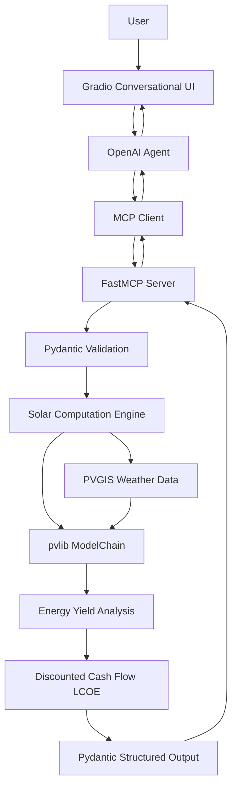

# Solar Intelligence
### Building Reliable AI Systems Around Scientific Computing

An Applied AI application that transforms solar project requirements into energy yield and Levelized Cost of Energy (LCOE) estimates through conversational AI, deterministic scientific computing, and agentic tool orchestration.

**[Live Application](https://huggingface.co/spaces/aianirudh/solar-yield-lcoe-estimator-mcp)**

`Python` `OpenAI Agents SDK` `FastMCP` `MCP` `Pydantic` `pvlib` `PVGIS` `Gradio`

---

## The Business Problem

Evaluating a utility scale solar project requires combining geographical weather data, photovoltaic simulation, energy production estimates, and long term financial modeling.

These workflows involve specialized engineering tools and multiple disconnected steps.

The opportunity was to make complex technical and financial evaluations accessible through natural language without compromising computational reliability.

## The Solution

I engineered a conversational AI application around a deterministic solar simulation and financial computation engine.

Users describe project requirements in natural language. An OpenAI agent interprets the request and orchestrates structured MCP tool calls to execute the underlying Python computations.

**AI orchestrates. Deterministic Python calculates.**

The application combines:

- **Solar simulation:** pvlib ModelChain with PVGIS Typical Meteorological Year weather data.
- **Energy analysis:** Hourly photovoltaic simulation, annual energy production, specific yield, capacity factor, and monthly generation.
- **Financial modeling:** Discounted cash flow LCOE using CAPEX, OPEX, degradation, discount rate, and project lifetime.
- **Agent orchestration:** OpenAI Agents SDK and FastMCP for structured tool execution.
- **Data reliability:** Pydantic schemas for validated inputs and structured outputs.

## Multi Project and Scenario Analysis

Go beyond individual solar estimates.

The agent can orchestrate multiple independent simulations across project locations and financial scenarios, then consolidate the results into a structured comparison.

Supported evaluation dimensions include:

- Multiple geographical locations and weather conditions.
- Different installed capacities and system configurations.
- Alternative CAPEX and OPEX assumptions.
- Varying discount rates and degradation assumptions.
- Multiple CAPEX adjusted Investment Tax Credit (ITC) scenarios.
- Comparative energy yield, capacity factor, and LCOE.

A single natural language request can coordinate multiple tool executions while maintaining consistent assumptions across scenarios.

This transforms individual engineering calculations into comparative project evaluation and financial decision support.

*ITC scenarios use simplified CAPEX adjustments rather than comprehensive tax credit eligibility and tax accounting models.*

## System Architecture

## Engineering Decisions

| Challenge | Engineering Approach |
|---|---|
| LLM numerical unreliability | Execute calculations using deterministic Python functions |
| Inconsistent tool inputs | Enforce typed contracts and validation using Pydantic |
| Agent and business logic coupling | Separate orchestration from computation using FastMCP |
| Complex photovoltaic modeling | Integrate pvlib ModelChain and PVGIS weather data |
| Financial reproducibility | Implement explicit discounted cash flow calculations |
| Multi step workflows | Orchestrate multiple structured tool executions through natural language |

## Technology Stack

| Layer | Technology |
|---|---|
| Language | Python |
| AI orchestration | OpenAI Agents SDK |
| Language model | GPT-5.4 mini |
| Tool integration | MCP / FastMCP |
| Data validation | Pydantic |
| Scientific computing | pvlib |
| Weather data | PVGIS |
| User interface | Gradio |
| Deployment | Hugging Face Spaces |

## What This Project Demonstrates

- **Applied AI Engineering:** Building domain specific AI applications around existing computational systems.
- **Agentic Systems:** Orchestrating multiple structured tool executions from natural language.
- **Reliable LLM Integration:** Separating probabilistic language model behavior from deterministic business logic.
- **Scientific Computing:** Integrating established photovoltaic simulation models with financial calculations.
- **AI Product Engineering:** Transforming complex engineering workflows into accessible decision support applications.

The underlying idea is simple: make sophisticated engineering workflows accessible through AI while keeping critical computations reproducible, transparent, and reliable.
