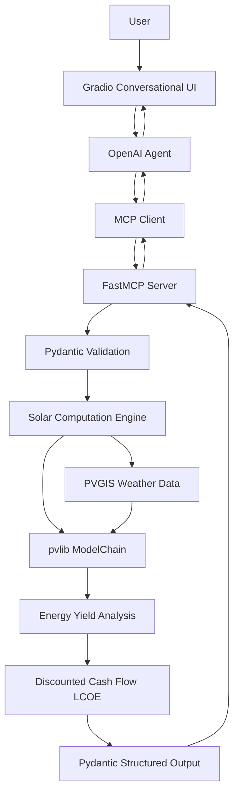

# Solar Intelligence
### Engineering a Reliable AI Enabled Solar Project Evaluation System

An Applied AI project that transforms solar project assumptions into energy yield and Levelized Cost of Energy (LCOE) estimates through conversational AI, deterministic scientific computing, and structured tool orchestration.

**[Live Application](https://huggingface.co/spaces/aianirudh/solar-yield-lcoe-estimator-mcp)** | **[GitHub Repository](https://github.com/anirudhsshirahati/solar-yield-lcoe-estimator-mcp)**

`Python` `OpenAI Agents SDK` `FastMCP` `MCP` `Pydantic` `pvlib` `PVGIS` `Gradio`

---

## The Business Problem

Evaluating a utility scale solar project requires combining location specific weather data, photovoltaic system modeling, energy production estimates, and long term financial assumptions.

These calculations traditionally involve specialized engineering tools and multiple disconnected workflows.

The challenge: make technical and financial project evaluation accessible through a conversational interface without compromising the accuracy and reproducibility of the underlying calculations.

## The Solution

I engineered a conversational AI application around a deterministic solar simulation and financial computation engine.

Users describe their solar project requirements in natural language. An AI agent interprets the request, invokes structured MCP tools, and orchestrates the underlying Python computation engine.

The system combines:

- **Solar simulation:** pvlib ModelChain with PVGIS Typical Meteorological Year weather data.
- **Energy analysis:** Hourly photovoltaic simulation, annual energy production, specific yield, capacity factor, and monthly generation.
- **Financial modeling:** Discounted cash flow LCOE incorporating CAPEX, OPEX, degradation, discount rate, and project lifetime.
- **AI orchestration:** OpenAI Agents SDK and FastMCP for structured tool invocation.
- **Data reliability:** Pydantic schemas for validated inputs and structured outputs.

**Core engineering principle: AI orchestrates. Deterministic Python calculates.**

## System Architecture

## Engineering Decisions

| Challenge | Engineering Approach |
|---|---|
| LLM numerical unreliability | Delegate engineering and financial calculations to deterministic Python functions |
| Inconsistent tool inputs | Define typed input contracts and validation using Pydantic |
| Agent and business logic coupling | Expose computation capabilities through a dedicated FastMCP server |
| Complex photovoltaic modeling | Integrate pvlib ModelChain and PVGIS weather data |
| Financial reproducibility | Implement explicit discounted cash flow calculations |
| Natural language accessibility | Build a conversational interface using Gradio and the OpenAI Agents SDK |

## Technical Implementation

**Photovoltaic Simulation**

Uses pvlib to model a utility scale single axis tracking photovoltaic system with configurable system capacity, DC to AC ratio, and system losses.

**Weather Integration**

Retrieves hourly Typical Meteorological Year weather data from PVGIS for the specified project coordinates.

**Energy Yield Analysis**

Processes hourly AC power output to derive annual generation, specific yield, capacity factor, and monthly generation.

**Financial Modeling**

Calculates LCOE using discounted project costs and discounted lifetime energy production, accounting for annual degradation.

\[
LCOE =
\frac{
CAPEX+\sum_{t=1}^{N}\frac{OPEX_t}{(1+r)^t}
}{
\sum_{t=1}^{N}\frac{E_t}{(1+r)^t}
}
\]

The current implementation calculates unsubsidized LCOE.

## Computational Scope

| Capability | Implemented Scope |
|---|---:|
| Simulation resolution | 8,760 hourly observations per typical year |
| Generation reporting | 12 monthly periods |
| PV configuration | Single axis tracking |
| Financial projection | Up to 50 years |
| Weather source | PVGIS TMY |
| Solar simulation | pvlib ModelChain |
| Financial calculation | Discounted cash flow |

*These represent implemented model capabilities, not independently benchmarked performance improvements.*

## Technology Stack

| Layer | Technology |
|---|---|
| Language | Python |
| AI orchestration | OpenAI Agents SDK |
| Language model | GPT-5.4 mini |
| Tool integration | FastMCP and MCP |
| Input and output contracts | Pydantic |
| Scientific computing | pvlib |
| Weather data | PVGIS |
| User interface | Gradio |
| Deployment | Hugging Face Spaces |

## Why This Project Matters

This project demonstrates an approach to Applied AI engineering that goes beyond connecting a language model to an API.

It brings together:

- Agentic AI and tool orchestration.
- Model Context Protocol integration.
- Structured outputs and input validation.
- Deterministic scientific computing.
- Domain specific financial modeling.
- Conversational product development.

The objective is to make complex engineering workflows accessible through AI while keeping critical calculations reproducible, transparent, and grounded in established computational models.

---
